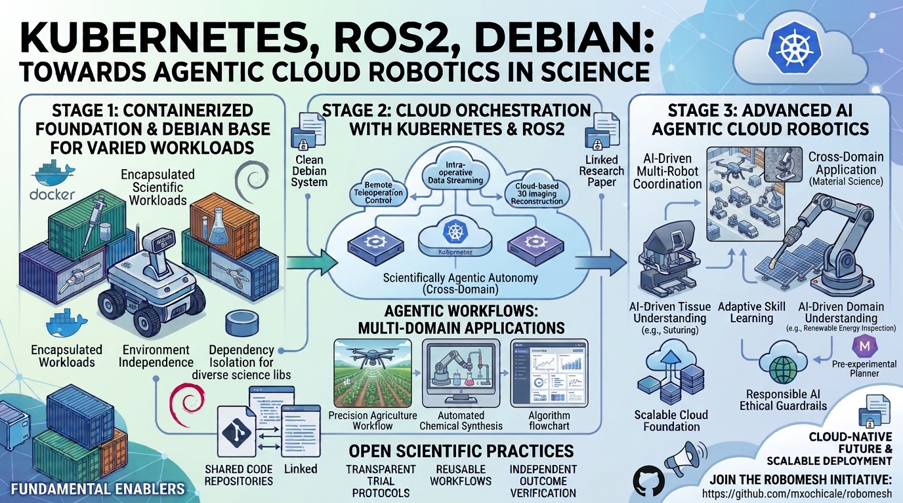

# 🤖 robomesh

> **Modernising Cloud Robotics: Debian · Kubernetes · ROS 2 · Agentic AI for Open Science.**

**Our mission**

Building open, interoperable and reproducible cloud robotics by connecting robotic systems, distributed infrastructure and intelligent agents.

## 🌍 What we explore

- 🐧 **Debian:** Reproducible robotics environments.
- ☸️ **Kubernetes:** Distributed robotics orchestration.
- 🤖 **ROS 2:** Interoperable robotics integration.
- 🧠 **Agentic AI:** Intelligent and autonomous robotics.

## 🤝 Join the Community

Researchers, developers and robotics enthusiasts are welcome!

- 💡 Share ideas and challenges.
- 🧪 Experiment with workflows.
- 🛠️ Contribute code and documentation.
- 🌍 Build and demonstrate together.

**Getting started:** [Community Roadmap](docs/roadmap.md) · [Good First Issues](https://github.com/mxochicale/robomesh/issues?q=is%3Aissue+state%3Aopen+label%3A%22good+first+issue%22)

💬 [Join the discussion](https://github.com/mxochicale/robomesh/discussions)

**Open technologies. Reproducible robotics. Shared progress.**
