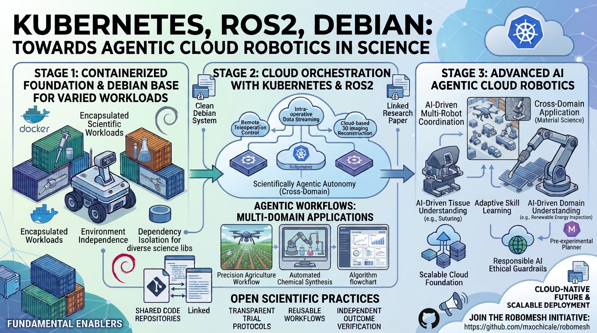

# Proposal talk

## Title: 

## Abstract: 

## Submission Notes (Optional):
> These notes are meant for the organiser and won't be made public.

## Session Image (Optional)

## Aditional Speaker:
> If you have an additional speaker, please add their email address here, and we will invite them to create an account. If you have more than one extra speaker, you can add them after finishing the proposal process.

## Additional Material (not included in the submission)

* ROS Kubernetes / KubeEdge, Repository: https://github.com/fujitatomoya/ros_k8s/tree/main
* Container Orchestration with Kubernetes for ROS-Based Robot Software DOI: https://www.mdpi.com/2076-3417/16/17/8761
