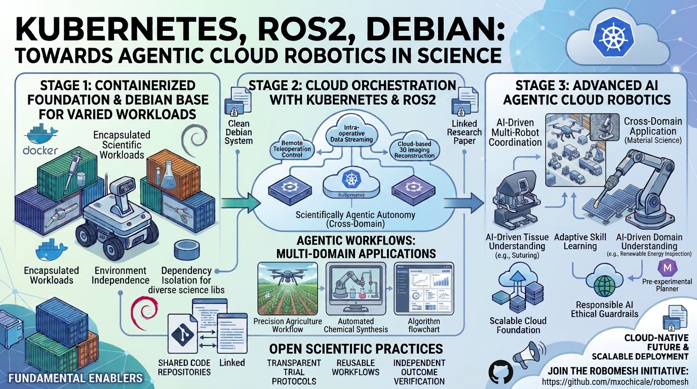
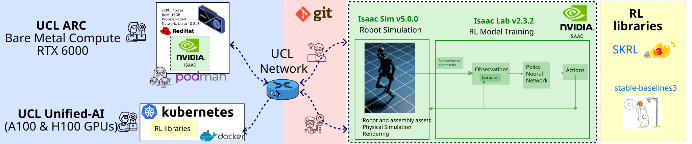
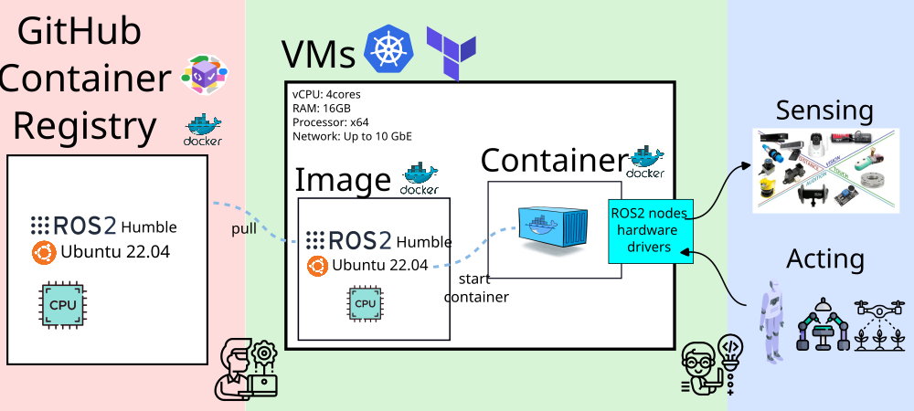
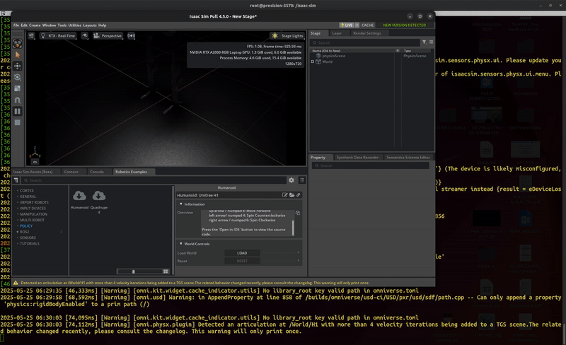
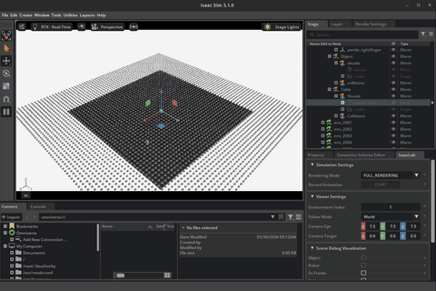
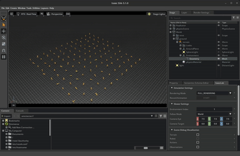
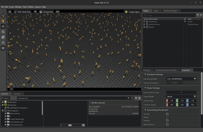
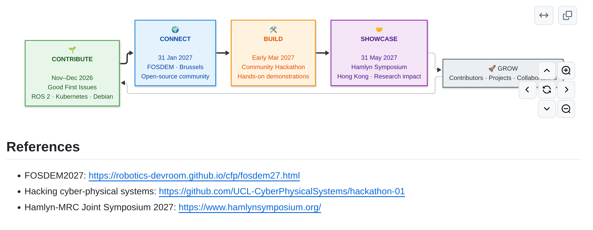
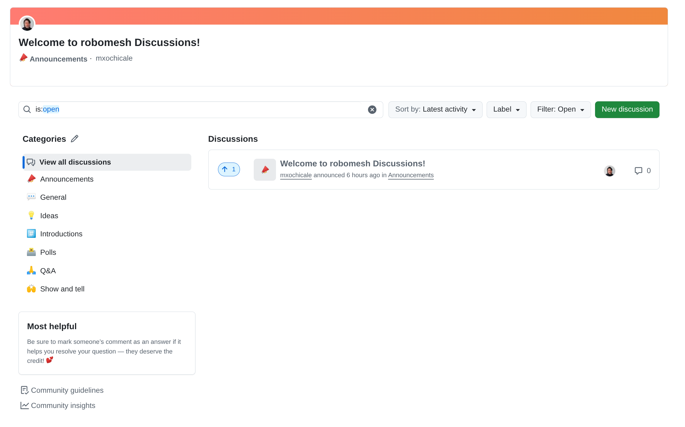

# {.title-slide .centeredslide background-iframe="https://mxochicale.github.io/web-animations/" loading="lazy"}

::: {style="background: rgba(10,10,14,0.72);
  backdrop-filter: blur(6px);
  border: 1px solid rgba(255,255,255,0.08);
  border-radius: 18px;
  text-align:center;
  padding: 1.1em 1.8em;
  max-width: max-content;
  margin-left: auto;
  margin-right: auto;
  line-height: 1.5em!important;
  box-shadow: 0 20px 60px rgba(0,0,0,0.45);"}

<span class="kicker">Open · Reproducible · Ready to fork</span>

<span style="color:#f5f5f7; font-size:1.75em; text-align:center; display:block;">

<!-- TODO: replace with the real talk title -->

[Modernising Cloud Robotics:]{style="color:#e0e0e0; font-size:1.65em; display:block; font-weight:600;"}

[Orchestrating Ubuntu/Debian, Kubernetes & ROS 2]{style="color:#e0e0e0; font-size:1.0em; display:block; font-weight:600;"}


</span>

[ [**Tomoya Fujita**](http://name-surname.github.io/),
[** Rafael Arrais**](http://name-surname.github.io/),
[**Miguel Xochicale**](http://name-surname.github.io/) ·
[OrgA, OrgB, OrgC](https://www.ucl.ac.uk/advanced-research-computing/)
]{style="font-size:0.55em; color:#b7bdc9;"}

::: {.badge-row}
[⭐ GitHub repo](https://github.com/mxochicale/robomesh){.badge}
[📄 License: Apache 2.0](#){.badge}
[🔗 DOI: 10.xxxx/xxxxx](#){.badge}
:::

:::

::: footer
[Add Event name?, date? and place? ·
[web-animations 2025 by mxochicale](https://mxochicale.github.io/web-animations/)]{.dim-text style="text-align:left;"}
:::

::: {.notes}
<!-- TODO: add opening speaker notes -->
:::


<!-- ============================================================
     OVERVIEW
     ============================================================ -->
## Overview {.smaller}

1. **Introduction** — Modernising robotics skills at UCL
2. **Infrastructure** — Cloud, network & physical layers
3. **Demonstrations** — Real use cases & live tooling
4. **Future Work** — Next hackathons & calls to action


<!-- ============================================================
     SECTION: INTRODUCTION
     ============================================================ -->
# Introduction {#Introduction background-color="#1a1a2e"}
**Modernising Robotics Skills**

::: {.notes}
Set the scene: why does UCL need modernised robotics infrastructure?
The challenge is bridging simulation, cloud compute, and real sensors
in a way that's accessible to researchers and students.
:::


<!-- ============================================================ -->
## :wrench: Hacking Cloud Brains, Physical Sensors, and the Network, and Orchestrating Talent

::: {#fig-hackathon}
{fig-align="center" width="90%"}

*Participants working across cyber-physical systems, cloud layers, and sensor networks at UCL Here East.*
:::

::: {.notes}
Describe the hackathon format: participants connected VMs, physical sensors,
and cloud nodes in a supervised setting. This became the model for scaling
robotics education at UCL.
:::


<!-- ============================================================ -->
## :wrench: Orchestrating Debian · Kubernetes · ROS 2

::: {#fig-hackathon}
{fig-align="center" width="90%"}

Towards agentic cloud robotics in science
:::

::: {.notes}
Describe the hackathon format: participants connected VMs, physical sensors,
and cloud nodes in a supervised setting. This became the model for scaling
robotics education at UCL.
:::


<!-- ============================================================
     SECTION: UCL INFRASTRUCTURE
     ============================================================ -->
# Orchestrating Cloud, Network, and Physical Sensor {#ucl-infrastructure background-color="#0d1b2a"}
**Modernising Robotics Skills**

::: {.notes}
Walk through the three layers: cloud VMs managed via Terraform/k8s,
the campus network, and physical hardware (sensors, robots).
:::


<!-- ============================================================ -->
## :robot: Cyber-physical infrastructure

::: {#fig-network}
{fig-align="center" width="88%"}

*Server topology and network communication across UCL's cyber-physical infrastructure.*
:::


::: {.notes}
Key point: the infrastructure is reproducible. Terraform configs and container
images are versioned on GitHub, so any team can spin up the same environment.

::: {.callout-tip collapse="true"}
## Infrastructure Stack
- **Compute**: VMs managed with Terraform + Kubernetes (k8s)
- **Containers**: ROS 2 images via GitHub Container Registry
- **Middleware**: `zenoh-plugin-ros2dds` for VM↔VM and bare-metal↔VM bridging
- **Networking**: High-performance campus fabric, 10 Gbps+ links
:::

:::


<!-- ============================================================ -->
## :robot: sim2real-humanoid-pipeline

::: {#fig-network}
{fig-align="center" width="88%"}

*UCL-ARC infrastructure, integrating simulators such as
Isaac Lab with reinforcement learning frameworks and algorithms (skrl and stable-baselines3)
to support scalable, distributed training and deployment workflows.*
:::


<!-- ============================================================
     SECTION: DEMOS
     ============================================================ -->
# Demonstrations {#demos background-color="#0f2027"}
**Cloud Brains · Physical Sensors · Real Networks**

::: {.notes}
Three demos: (1) VM-to-VM ROS 2 comms via zenoh,
(2) IsaacSim interactive control, (3) IsaacLab RL training at scale.
:::


<!-- ============================================================ -->
## Demo 1. VM↔VM Communication with `zenoh-plugin-ros2dds` {.smaller}

:::: {.columns}

::: {.column width="35%"}
### What Was Built

- ROS 2 Docker container pushed to GitHub Container Registry
- VMs provisioned and torn down with **Terraform + k8s**
- `zenoh-plugin-ros2dds` bridges DDS traffic across VM boundaries
- Enables bare-metal ↔ VM and VM ↔ VM ROS 2 topic sharing with **zero config changes** on the robot side


:::

::: {.column width="65%"}
::: {#fig-pipeline}
{fig-align="center"}

*End-to-end pipeline: container build → registry → VM deployment → zenoh bridge → ROS 2 topic relay.*
:::
:::

::::

::: {.notes}
Emphasise that the zenoh bridge makes the infrastructure topology transparent
to application code. ROS 2 nodes don't need to know they're crossing VM boundaries.

::: {.callout-note icon=false}
**Repo**: [UCL-CyberPhysicalSystems/hackathon-01](https://github.com/UCL-CyberPhysicalSystems/hackathon-01)
:::

:::


<!-- ============================================================ -->
## Demo 2. IsaacSim & IsaacLab {.smaller}

:::: {.columns}

::: {.column width="38%"}

::: {#fig-isaacsim}
{fig-align="center" width="70%"}

*IsaacSim IDE: interactive robot key control.*
:::

::: {#fig-franka}
{fig-align="center" width="70%"}

*Franka Lift Cube — RL policy training.*
:::

:::

::: {.column width="60%"}

::: {#fig-humanoid-train}
{fig-align="center" width="70%"}

*Humanoid training — 128 parallel environments, 2000 iterations.*
:::

```{.bash code-line-numbers="false"}
# Train
./isaaclab.sh -p scripts/reinforcement_learning/rsl_rl/train.py \
  --task Isaac-Humanoid-v0 --num_envs 128 \
  --max_iterations 2000 --headless

# Play / evaluate
./isaaclab.sh -p scripts/reinforcement_learning/rsl_rl/play.py \
  --task Isaac-Humanoid-v0 --num_envs 1000 \
  --checkpoint logs/rsl_rl/humanoid
```

:::

::::

::: {.notes}
IsaacLab unlocks GPU-parallelised RL training on UCL's compute nodes.
Highlight the jump from 128 envs (training) to 1000 envs (evaluation)
as evidence of the infrastructure's headroom.


{fig-align=center}

./isaaclab.sh -p scripts/reinforcement_learning/rsl_rl/train.py
--task Isaac-Humanoid-v0 --num_envs 128 --max_iterations 2000 --headless

{fig-align=center}

./isaaclab.sh -p scripts/reinforcement_learning/rsl_rl/play.py
--task Isaac-Humanoid-v0 --num_envs 1000 --checkpoint logs/rsl_rl/humanoid


:::


<!-- ============================================================
     SECTION: FUTURE WORK & TAKEAWAYS
     ============================================================ -->
# Future Work {#tacfa background-color="#1a1a2e"}

::: {.notes}
Wrap up: upcoming hackathons, what the community should take away,
and a concrete call to action for collaboration and funding.
:::


<!-- ============================================================ -->
## 🌍 Community Roadmap

::: {#fig-hackathon}
{fig-align="center" width="90%"}

https://github.com/mxochicale/robomesh

:::

::: {.notes}
Describe the hackathon format: participants connected VMs, physical sensors,
and cloud nodes in a supervised setting. This became the model for scaling
robotics education at UCL.
:::


<!-- ============================================================ -->
## Upcoming Events {.smaller}


::: {.callout-tip icon=false}
## :calendar: Hackathon 2 — **Q1 2027**
**Larger Collaborative Hackathon**
Explore ideas · Create research projects
📍 TBC
:::

[**Register / follow progress →**](https://github.com/UCL-CyberPhysicalSystems/hackathon-02)


::: {.notes}
Hackathon 1 is a low-stakes day to validate the setup with a small group.
Hackathon 2 opens it to a much larger audience with external collaborators.
:::


<!-- ============================================================ -->
## Key Takeaways

::: {style="font-size: 90%;"}

::: {.incremental}
- **:unlock: Lowering the barrier to advanced robotics**
Cloud-ready, cost-aware infrastructure enables hands-on training with real sensors
and real network constraints, without specialist hardware budgets.

- **:arrows_counterclockwise: A proven, scalable model for collaboration**
High-performance networking and shared platforms make cross-department and
cross-institution work practical and repeatable.

- **:test_tube: A living testbed for research & training**
The infrastructure supports skills transfer, rapid prototyping of
robotics workflows, and publishable research experiments.

- **:handshake: Call to Action**
Partner with us to extend the testbed. We are actively seeking collaboration and
funding to scale training, expand use cases, and deploy beyond UCL.
:::


:::

::: {.notes}
Deliver these one at a time with the incremental reveal.
End on the call to action — have contact details ready.


1. Lowering the Barrier to Advanced Robotics
2. A Scalable Model for Cross-Department Collaboration
3. Real Sensors, Real Networks, Real Constraints
4. High-Performance Networking Enables New Workflows
5. Cloud-Ready Robotics Training at Scale
6. Hands-On Learning Accelerates Skills Transfer
7. Cost-Aware, Sustainable Infrastructure Design
8. A Testbed for Research, Training, and Innovation
9. Clear Opportunities for Collaboration & Funding

**Sciortino et al. 2017** in Computers in Biology and Medicine https://doi.org/10.1016/j.compbiomed.2017.01.008;
**He et al. 2021** in Front. Med. https://doi.org/10.3389/fmed.2021.729978

:::


<!-- ============================================================ -->
## Thank You · Let's Connect {.smaller}

:::: {.columns}

::: {.column width="50%"}
### UCL CEGE
[Mickey Li](https://github.com/mhl787156) ·
[Chris Bendkowski](https://github.com/ctbend)

### UCL ARC
[Marlon Wijeyasinghe](https://github.com/mwij02) ·
[James Legg](https://github.com/cjlegg) ·
[Mack Nixon](https://github.com/TOADD) ·
[Mahmoud Abdelrazek](https://github.com/TOADD) ·
[Sunny Park](https://github.com/TOADD) ·
[Emily Dubrovska](https://github.com/pineapple-cat) ·
[Yagmur Ozdemir](https://github.com/yidilozdemir) ·
[Ruaridh Gollifer](https://github.com/ruaridhg) ·
[Samantha Ahern](https://github.com/quirksahern) ·
[James Hetherington](https://github.com/jamespjh)
:::

::: {.column width="50%"}
### Teams

**Unified-AI**: Sylvie Ramos et al.

**Condenser**: Brian Maher et al.

---

::: {.callout-note icon=false}
## :speech_balloon: Get in Touch
**GitHub**: [github.com/mxochicale](https://github.com/mxochicale)
**UCL ARC**: [ucl.ac.uk/arc](https://www.ucl.ac.uk/arc)
**Hackathon repo**: [UCL-CyberPhysicalSystems/hackathon-01](https://github.com/UCL-CyberPhysicalSystems/hackathon-01)
:::
:::

::::

::: {.notes}
Thank the room. Leave the slide up during questions —
GitHub handle and repo URL are visible for anyone who wants to follow up.
:::


<!-- ============================================================ -->
##  Thank You · Let's Connect

::: {#fig-hackathon}
{fig-align="center" width="90%"}

https://github.com/mxochicale/robomesh/discussions

:::

::: {.notes}
Describe the hackathon format: participants connected VMs, physical sensors,
and cloud nodes in a supervised setting. This became the model for scaling
robotics education at UCL.
:::


<!-- ============================================================
     EXTRA SLIDES (appendix)
     ============================================================ -->
# Appendix {background-color="#111111"}

Extra slides for Q&A


<!-- ============================================================ -->
## My Journey {#sec-mt .smaller}

{fig-align="center" width="100%"}

::: {.notes}
Use this slide if asked about background — brief overview of the path
from robotics research to ARC infrastructure work.
:::
